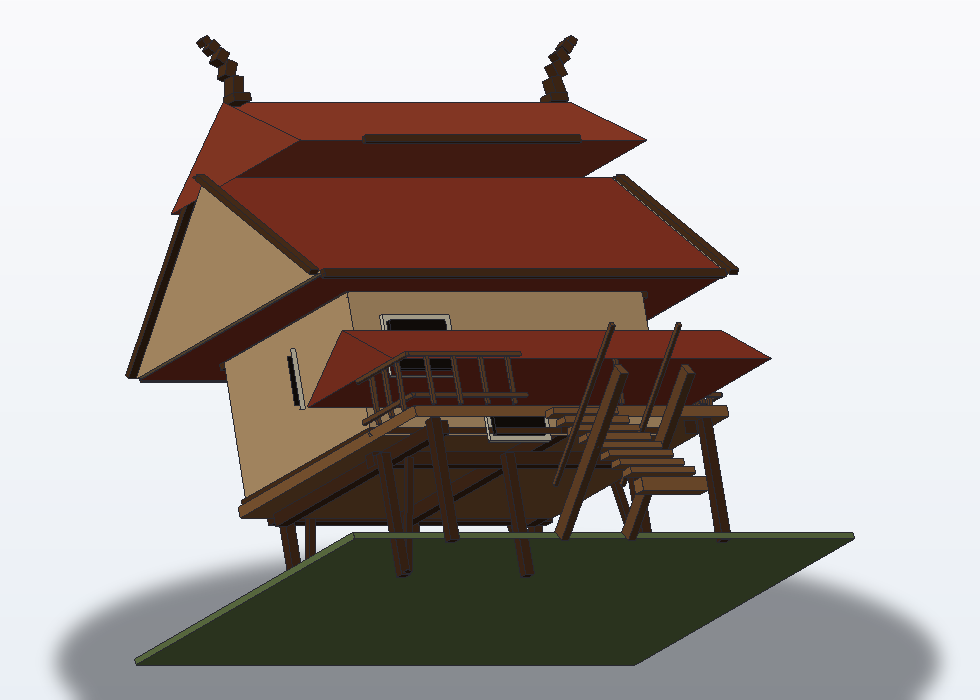
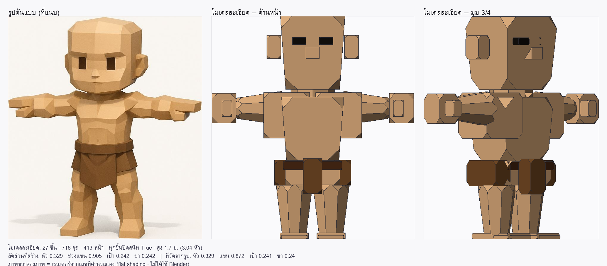

# Hermes Blender MCP — ให้ AI สั่งงาน Blender ได้จริง

MCP Server ตัวเดียวที่เชื่อม **Hermes Agent** เข้ากับ **Blender 5.2**
ให้ AI อ่านฉาก สร้าง/ขยับวัตถุ ใส่สี ถ่ายภาพหน้าจอ และรันสคริปต์ `bpy` ได้จากในแชท

> **สรุป 30 วินาที**
> - **ต้องมี:** Blender 5.2 + Python 3.10 ขึ้นไป (ของเครื่อง ไม่ใช่ของ Blender)
> - **ติดตั้ง:** ดับเบิลคลิก `install-windows.bat` (หรือ 3 คำสั่งบน Linux/macOS)
> - **ใช้งาน:** `hermes mcp add blender ...` แล้วสั่งเป็นภาษาธรรมชาติ
> - **ไม่ต้อง** ติดตั้ง add-on ใน Blender และ **ไม่ต้อง** `pip install` อะไรลง Blender เลย

[](https://github.com/suradath/Hermes-blender-mcp/actions/workflows/tests.yml)
**สถานะ:** ชุดทดสอบอัตโนมัติ **795 ข้อ (11 ชุด) ผ่านหมด** · ทดสอบกับ Blender 5.2.2 จริงบน Windows 11 แล้ว
· [ทดสอบอะไรแล้ว / ยังไม่ได้ทดสอบอะไร](#ทดสอบอะไรแล้ว--ยังไม่ได้ทดสอบอะไร)



*🏠 **บ้านทรงไทยโพลิกอน** — 88 ชิ้น สร้างจากเรขาคณิตจริง (ไม่ได้ปั้นมือ · ไม่ได้ใช้ภาพจาก AI)
เสายกพื้น · หลังคาซ้อนชั้นชัน 40.6° · หน้าบัน · ป้านลม · ช่อฟ้าโค้ง · ระเบียง · บันได
— [ดูวิธีสร้างในคู่มือ §10](docs/03-สร้างตัวละครจากรูป.md#10-ตัวอย่างที่-2-บ้านทรงไทยสไตล์โพลิกอน)*

---

## ⚡ เริ่มเร็ว (5 นาที)

**Windows 11:**

```bat
cd C:\Hermes-blender-mcp
install-windows.bat                       :: 1) ติดตั้ง (สร้าง venv + ตรวจ Blender)
run-hermes-blender-mcp.bat --selftest     :: 2) ทดสอบเปิด Blender จริง
hermes mcp add blender --command "C:\Hermes-blender-mcp\.venv\Scripts\python.exe" ^
  --connect-timeout 120 --args C:\Hermes-blender-mcp\blender_mcp_server.py   :: 3) ต่อ Hermes
```

**Linux / macOS:**

```bash
cd Hermes-blender-mcp
python3 -m venv .venv && ./.venv/bin/pip install -r requirements.txt
./.venv/bin/python blender_mcp_server.py --check
hermes mcp add blender --command "$PWD/.venv/bin/python" --connect-timeout 120 \
  --args "$PWD/blender_mcp_server.py"
```

เสร็จแล้วเปิดเซสชันใหม่ แล้วลองสั่ง: *"ใช้ Blender สร้างลูกบาศก์ที่ (0,0,3) ใส่สีแดง แล้วบอกว่าฉากมีอะไรบ้าง"*

> ⚠️ **กับดักอันดับ 1:** `--args` ต้องอยู่ **ท้ายสุด** ของคำสั่ง `hermes mcp add` เสมอ —
> ถ้ามี option อื่นต่อท้าย มันจะถูกกลืนเป็นอาร์กิวเมนต์ของเซิร์ฟเวอร์ แล้วได้แค่ `Connection closed`
> (รายละเอียดใน [ขั้นที่ 5](#ขั้นที่-5--ต่อเข้ากับ-hermes-agent))

---

## 📚 สารบัญ

1. [มันทำอะไรได้](#1-มันทำอะไรได้)
2. [ก่อนติดตั้ง — ต้องมีอะไร](#2-ก่อนติดตั้ง--ต้องมีอะไร)
3. [ติดตั้งทีละขั้น (ละเอียด)](#3-ติดตั้งทีละขั้น-ละเอียด)
4. [ต่อเข้ากับ Hermes — ข้อมูลเชิงลึก](#4-ต่อเข้ากับ-hermes--ข้อมูลเชิงลึก)
5. [ลองสั่งงานครั้งแรก](#5-ลองสั่งงานครั้งแรก)
6. [ทำไมต้องแยกเป็นสองโปรเซส](#6-ทำไมต้องแยกเป็นสองโปรเซส)
7. [เครื่องมือทั้งหมด 12 ตัว](#7-เครื่องมือทั้งหมด-12-ตัว)
8. [ความปลอดภัยของ execute_blender_script](#8-ความปลอดภัยของ-execute_blender_script)
9. [แก้ปัญหา](#9-แก้ปัญหา)
10. [ทดสอบ / สถานะความน่าเชื่อถือ](#10-ทดสอบ--สถานะความน่าเชื่อถือ)
11. [บทเรียนจากการพัฒนา](#11-บทเรียนจากการพัฒนา)
12. [แผนผังไฟล์ + เอกสาร](#12-แผนผังไฟล์--เอกสาร)
13. [เปรียบเทียบกับโครงการอื่น](#13-เปรียบเทียบกับโครงการอื่น)
14. [อ้างอิง](#14-อ้างอิง)

---

## 1. มันทำอะไรได้

พูดกับ AI เป็นภาษาธรรมชาติ แล้วมันสั่ง Blender ให้:

| คุณพูด | AI ทำ |
|---|---|
| "ฉากนี้มีอะไรบ้าง" | อ่านคอลเลกชัน วัตถุ transform จำนวนจุดยอด แล้วสรุปให้ |
| "สร้างลูกบาศก์ที่ (0,0,3) ย่อครึ่ง ใส่สีแดง" | สร้าง + ขยับ + ใส่วัสดุ Principled BSDF |
| "ขยับเก้าอี้ไปทางขวา 2 เมตร แล้วหมุน 45 องศา" | ขยับแบบ relative ได้ |
| "ถ่ายภาพให้ดูหน่อยว่างานออกมาเป็นยังไง" | เรนเดอร์ภาพส่งกลับมาเป็นรูปจริง (AI "เห็น" ได้) |
| "โหลดเก้าอี้ฟรีจาก Poly Haven มาวาง" | ค้นคลัง CC0 แล้วดาวน์โหลด + ใส่เข้าฉาก (ไม่ต้องใช้คีย์) |
| "เขียนสคริปต์สร้างเกลียว 50 วง" | รัน `bpy` ดิบ (ผ่านด่านความปลอดภัย) |



*ซ้าย = รูปต้นแบบ · กลาง/ขวา = โมเดล 27 ชิ้นที่สร้างจากเรขาคณิตของโปรเจกต์
(เรนเดอร์ด้วย `tools/render_flat.py` — ยังไม่ได้ใช้ Blender) · [คู่มือ §7–§8](docs/03-สร้างตัวละครจากรูป.md)*

**ตัวอย่างที่สร้างได้จากโค้ดในโปรเจกต์:**

- 🧍 ตัวละครโพลิกอน 27 ชิ้น — [`tools/character_builder.py`](tools/character_builder.py)
- 🏠 บ้านทรงไทย 88 ชิ้น (หลังคาซ้อน · ช่อฟ้า · ระเบียง · บันได) — [`tools/thai_house_builder.py`](tools/thai_house_builder.py)
- 🌳 ต้นไม้ — [`tools/tree_builder.py`](tools/tree_builder.py) · 🐕 สุนัข — [`tools/dog_builder.py`](tools/dog_builder.py)
- 🏘️ ภาพหมู่ทั้งฉาก — [`tools/scene_builder.py`](tools/scene_builder.py)

> 🧍 **สร้างตัวละคร 3D จากรูปที่แนบมาได้ไหม?** ได้ — แต่ต้องเข้าใจขอบเขต:
> Hermes ดูรูป → ประเมินสัดส่วน/สี → สร้าง **blockout** ลงฉาก → ถ่ายภาพกลับมาดู → ปรับวนซ้ำ
> ([คู่มือ](docs/03-สร้างตัวละครจากรูป.md) · [ตัวอย่างที่รันได้](examples/character_blockout.py))
> ส่วน **ปั้นละเอียดจากรูปอัตโนมัติ (image-to-3D) ไม่มีในตัว** เพราะต้องใช้บริการภายนอกที่มีคีย์
> — โปรเจกต์นี้เลือกไม่ผูกกับคีย์ จึงบอกตรง ๆ ว่าอะไรทำได้/ทำไม่ได้

---

## 2. ก่อนติดตั้ง — ต้องมีอะไร

| สิ่งที่ต้องมี | ขั้นต่ำ | วิธีตรวจ | ควรเห็น |
|---|---|---|---|
| **Blender** | 5.2 LTS (ใช้ได้ตั้งแต่ 4.0) | เปิด Blender → `Help > About Blender` | `5.2.x` |
| **Python ของเครื่อง** | 3.10 ขึ้นไป (ทดสอบ 3.12 / 3.14) | `python --version` | `Python 3.10` ขึ้นไป |
| **Hermes Agent** | รุ่นที่มี MCP client | `hermes --version` | เลขเวอร์ชันอะไรก็ได้ |
| **แพ็กเกจ `mcp`** | 2.x (`mcp>=2.0,<3`) | ตัวติดตั้งจัดการให้ | — |

> ⚠️ **`mcp` 2.x เปลี่ยนชื่อ `FastMCP` → `MCPServer`** — โค้ดนี้ใช้ API ของ 2.x
> ถ้าติดตั้ง `mcp<2` จะใช้ไม่ได้ และตัวอย่างเก่า ๆ บนอินเทอร์เน็ตส่วนใหญ่ยังเป็น 1.x

> 💡 **แนะนำ:** วางโฟลเดอร์โปรเจกต์ในพาธที่**ไม่มีช่องว่างและไม่มีอักษรไทย**
> เช่น `C:\Hermes-blender-mcp` — ลดปัญหาการอ้างพาธใน batch/PowerShell

---

## 3. ติดตั้งทีละขั้น (ละเอียด)

ทำตามลำดับ 6 ขั้น แต่ละขั้นมี "ควรเห็นแบบนี้" ให้เทียบ — ถ้าไม่ตรง ให้ดู [ข้อ 9 แก้ปัญหา](#9-แก้ปัญหา)

### ขั้นที่ 1 — ดาวน์โหลดโค้ด

**วิธี ก (แนะนำ ถ้ามี git):**

```bat
cd C:\
git clone https://github.com/suradath/Hermes-blender-mcp.git
cd Hermes-blender-mcp
```

**วิธี ข (ไม่มี git):** เปิด <https://github.com/suradath/Hermes-blender-mcp> →
ปุ่ม **Code** → **Download ZIP** → แตกไฟล์ไปที่ `C:\Hermes-blender-mcp`

✅ **ควรเห็น:** ในโฟลเดอร์มี `blender_mcp_server.py`, `blender_bridge.py`, `install-windows.bat`

### ขั้นที่ 2 — รันตัวติดตั้ง

```bat
C:\Hermes-blender-mcp\install-windows.bat
```

(ดับเบิลคลิกก็ได้) สคริปต์ทำให้ 4 อย่าง:

1. หา Python ของเครื่อง
2. สร้าง `.venv` ในโฟลเดอร์โปรเจกต์
3. ติดตั้งแพ็กเกจ `mcp` จาก `requirements.txt`
4. **ตรวจว่าเจอ Blender ไหม** แล้วพิมพ์ค่า config ให้คัดลอก

✅ **ควรเห็นแบบนี้:**

```
============================================================
  Hermes Blender MCP - Windows 11 installer
  ติดตั้ง Hermes Blender MCP สําหรับ Windows 11
============================================================
[1/4] Using Python: python.exe
      version 3.13.5
[2/4] Creating venv in .venv ...
[3/4] Installing required packages ...
[4/4] Checking the installation ...
Blender: C:\Program Files\Blender Foundation\Blender 5.2\blender.exe (เจอในเครื่อง (1 รุ่น))
สคริปต์สะพาน: C:\Hermes-blender-mcp\blender_bridge.py ✅
============================================================
  Done - Blender found.
  เสร็จแล้ว! เจอ Blender เรียบร้อย
```

❌ **ถ้าขึ้น `[X] Python not found`** → ติดตั้ง Python จาก <https://www.python.org/downloads/>
แล้ว **ติ๊ก "Add python.exe to PATH"** ตอนติดตั้ง จากนั้นรัน `install-windows.bat` ใหม่

❌ **ถ้าขึ้น `Packages OK, but Blender was not found`** → Blender อยู่ที่อื่น ทำขั้นที่ 3

### ขั้นที่ 3 — ตรวจว่าเจอ Blender (ถ้าขั้น 2 หาไม่เจอ)

```bat
C:\Hermes-blender-mcp\.venv\Scripts\python.exe C:\Hermes-blender-mcp\blender_mcp_server.py ^
  --check --blender "C:\Program Files\Blender Foundation\Blender 5.2\blender.exe"
```

✅ **ควรเห็น:**

```
Blender: C:\Program Files\Blender Foundation\Blender 5.2\blender.exe (ระบุเอง)
สคริปต์สะพาน: C:\Hermes-blender-mcp\blender_bridge.py ✅
```

> 📌 **จำพาธนี้ไว้** — ต้องใส่ `--blender "<พาธ>"` แบบเดียวกันตอนต่อ Hermes (ขั้นที่ 5)

**Linux / macOS:**

```bash
cd /path/to/Hermes-blender-mcp
python3 -m venv .venv
./.venv/bin/pip install -r requirements.txt
./.venv/bin/python blender_mcp_server.py --check
```

```
Blender: /usr/bin/blender (เจอใน PATH)
สคริปต์สะพาน: /path/to/Hermes-blender-mcp/blender_bridge.py ✅
```

### ขั้นที่ 4 — ทดสอบเปิด Blender จริง (แนะนำอย่างยิ่ง)

```bat
run-hermes-blender-mcp.bat --selftest      :: Windows
./run-hermes-blender-mcp.sh --selftest     :: Linux/macOS
```

คำสั่งนี้ **เปิด Blender จริง** แล้วไล่เรียกเครื่องมือทีละตัว (สร้างลูกบาศก์ → ขยับ →
ใส่สี → อ่านรายละเอียด → รันสคริปต์ → ลบ → ถ่ายภาพ) แล้วปิดให้เอง

✅ **ควรเห็นแบบนี้ (ตัดมาจากเครื่องจริง Windows 11 + Blender 5.2.2):**

```
── ตรวจการติดตั้ง (selftest) ──
[Hermes-blender-mcp] ใช้ Blender: C:\Program Files\Blender Foundation\Blender 5.2\blender.exe
[Hermes-blender-mcp] blender: [blender-bridge] พร้อมรับงานที่ 127.0.0.1:56652 (โหมด main thread / headless)
✅ ต่อได้ · Blender 5.2.2
✅ get_scene_hierarchy: {"scene": {"name": "Scene"}, ...}
✅ collection path: 2 คอลเลกชัน · ตัวอย่าง ['Scene Collection', 'Scene Collection/Collection']
✅ add_primitive_mesh: {"created": "LPM_Test", "primitive": "cube", ...}
✅ modify_object_transform: {"name": "LPM_Test", "after": {...}}
✅ set_object_material: {"object": "LPM_Test", "material": "LPM_0.9_0.2_0.2"}
✅ get_object_details: {"name": "LPM_Test", "type": "MESH", ...}
✅ execute_blender_script: {"ok": true, "result": 42}
✅ delete_object: {"deleted": true, "name": "LPM_Test"}
✅ get_viewport_screenshot: 320x240.png · 12345 ไบต์
✅ resource file_metadata: {"blender_version": "5.2.2", "scene": "Scene"}
── จบ ──
```

> 🔒 `--selftest` ใช้ `--factory-startup` = ฉากเริ่มต้น **ไม่แตะไฟล์ `.blend` ของคุณ**

❌ **ถ้าขึ้น `❌ เปิด Blender ไม่ได้`** → ยังไม่เจอ Blender ให้กลับไปขั้นที่ 3

### ขั้นที่ 5 — ต่อเข้ากับ Hermes Agent

**ตรวจก่อน (สำคัญ):** Hermes ต้องมีแพ็กเกจ `mcp` ใน Python ของตัวเอง
ไม่งั้นมันจะ **ปิดความสามารถ MCP เงียบ ๆ** — ไม่มี error แค่ไม่มีเครื่องมือขึ้นมา

```bash
python3 -c "import mcp; print('ok')"     # ถ้าล้มเหลว
~/.hermes/bin/uv pip install --python "$(which python3)" mcp
```

#### วิธีที่ 1 (แนะนำ) — คำสั่งเดียวจบ

```powershell
# Windows 11 (PowerShell) — ⚠️ --args ต้องอยู่ท้ายสุดเสมอ
hermes mcp add blender --command "C:\Hermes-blender-mcp\.venv\Scripts\python.exe" --connect-timeout 120 --args C:\Hermes-blender-mcp\blender_mcp_server.py
```

```bash
# Linux / macOS — แบ่งบรรทัดด้วย \ ได้ แต่ --args ยังต้องอยู่ท้ายสุด
hermes mcp add blender --command "/path/to/Hermes-blender-mcp/.venv/bin/python" \
  --connect-timeout 120 --args /path/to/Hermes-blender-mcp/blender_mcp_server.py
```

✅ **ควรเห็น (คัดจากเครื่องที่ทดสอบจริง):**

```
  Connecting to 'blender'...
  ✓ Connected! Found 12 tool(s) from 'blender':
    get_scene_hierarchy · add_primitive_mesh · modify_object_transform ...
  Enable all 12 tools? [Y/n/select]:
  ✓ Saved 'blender' to ~/.hermes/config.yaml (12/12 tools enabled)
  Start a new session to use these tools, or run /reload-mcp.
```

ตรวจซ้ำได้ทุกเมื่อ:

```bash
hermes mcp list            # ดูรายการ + สถานะ
hermes mcp test blender    # → ✓ Connected (1950ms) · ✓ Tools discovered: 12
hermes mcp remove blender  # ถ้าต้องการลบ
```

> ⚠️ **บทเรียนจริง:** รอบแรกที่ทดสอบ วาง `--connect-timeout` ไว้**หลัง** `--args`
> → มันถูกกลืนเป็นอาร์กิวเมนต์ของเซิร์ฟเวอร์ → เซิร์ฟเวอร์ออกทันที → เห็นแค่
> `✗ Failed to connect: Connection closed` ซึ่งชี้ทางผิดไปไกล
> **วาง `--connect-timeout` ไว้ก่อน `--args` เสมอ**

#### วิธีที่ 2 — แก้ `~/.hermes/config.yaml` เอง

```yaml
mcp_servers:
  blender:
    command: C:\Hermes-blender-mcp\.venv\Scripts\python.exe
    args:
      - C:\Hermes-blender-mcp\blender_mcp_server.py
    connect_timeout: 120.0
    timeout: 300            # งาน 3D ใช้เวลาได้ (ค่าปริยาย 120)
    enabled: true
```

| คีย์ | ค่าที่แนะนำ | เพราะ |
|---|---|---|
| `connect_timeout` | **120** | Blender ใช้เวลาหลายวินาทีในการเปิดตัว |
| `timeout` | **300** | สคริปต์/เรนเดอร์ใช้เวลาได้ |
| `env` | ปกติไม่ต้องใส่ | Hermes กรอง env — โค้ดมีค่าเริ่มต้นสำรองให้แล้ว |

> 📄 รายละเอียดเต็ม (env ที่ Hermes กรอง · รูปแบบ JSON `mcpServers` ของไคลเอนต์อื่น ·
> ตารางแก้ปัญหา) อยู่ใน [`docs/02-Hermes-config.md`](docs/02-Hermes-config.md)

#### เปิดไฟล์ `.blend` ของคุณตั้งแต่ต้น

```powershell
hermes mcp add blender --command "C:\Hermes-blender-mcp\.venv\Scripts\python.exe" --connect-timeout 120 `
  --args C:\Hermes-blender-mcp\blender_mcp_server.py --blend-file "C:\งาน\บ้าน.blend"
```

#### โหมดมีหน้าต่าง (attach) — เห็นภาพขณะ AI ทำ

ติดตั้ง add-on (ดู [`docs/01-ติดตั้ง-Windows11.md`](docs/01-ติดตั้ง-Windows11.md) หัวข้อสุดท้าย) →
กด **"เริ่มสะพาน"** ในแผง `View3D > Sidebar (N) > Blender MCP` → แล้วสั่ง Hermes ด้วย `--attach`:

```bash
hermes mcp add blender --command "..." --connect-timeout 60 \
  --args blender_mcp_server.py --attach 127.0.0.1:9876 --token "วาง_TOKEN_จากแผง"
```

### ขั้นที่ 6 — ตรวจว่าเครื่องมือขึ้นแล้ว

เริ่มเซสชันใหม่ (หรือพิมพ์ `/reload-mcp`) แล้วเครื่องมือจะขึ้นชื่อว่า
`mcp_blender_get_scene_hierarchy`, `mcp_blender_add_primitive_mesh`, … (12 ตัว)

✅ ถ้าเห็น 12 ตัว = พร้อมใช้งาน ไปต่อ [ข้อ 5 ลองสั่งงานครั้งแรก](#5-ลองสั่งงานครั้งแรก)

---

## 4. ต่อเข้ากับ Hermes — ข้อมูลเชิงลึก

ขั้นตอนหลักอยู่ใน [ขั้นที่ 5](#ขั้นที่-5--ต่อเข้ากับ-hermes-agent) แล้ว หัวข้อนี้เก็บรายละเอียด
ที่คนมักถามบ่อย

### ตรวจสถานะหลังต่อแล้ว

```bash
hermes mcp list                         # รายการเซิร์ฟเวอร์ + เปิด/ปิด
hermes mcp test blender                 # → ✓ Connected · ✓ Tools discovered: 12
hermes mcp configure blender            # เลือกเปิด/ปิดบางเครื่องมือ
```

### Hermes กรองตัวแปรสภาพแวดล้อม

โปรแกรมที่เปิดโปรเซสลูก (รวม Hermes) ส่ง env แบบ **กรองแล้ว** เท่านั้น (`PATH`, `HOME`,
`USER`, `LANG`, `TMPDIR`, `XDG_*`) ⇒ `PROGRAMFILES` / `LOCALAPPDATA` มักไม่ถึง Blender
**ส่งพาธตรง ๆ ชัวร์ที่สุด** (`--blender "C:\...\blender.exe"`) หรือใส่ `env:` ใน config

### ใช้กับไคลเอนต์ MCP อื่น (เช่น Claude Desktop)

รูปแบบ JSON มาตรฐาน `mcpServers` — ดูตัวอย่างใน [`docs/02`](docs/02-Hermes-config.md)

```json
{
  "mcpServers": {
    "blender": {
      "command": "C:\\Hermes-blender-mcp\\.venv\\Scripts\\python.exe",
      "args": ["C:\\Hermes-blender-mcp\\blender_mcp_server.py"]
    }
  }
}
```

### โหมดมีหน้าต่าง (เห็นภาพขณะ AI ทำ)

ต้องติดตั้ง add-on ก่อน (build zip → `Edit > Preferences > Add-ons > Install from Disk`)
แล้วกด **"เริ่มสะพาน"** ในแผง `N > Blender MCP` — ขั้นตอนละเอียดพร้อมภาพอยู่ใน
[`docs/01-ติดตั้ง-Windows11.md`](docs/01-ติดตั้ง-Windows11.md)

```bash
python tools/build_addon_zip.py            # สร้าง dist/blender_mcp_bridge-<ver>.zip
hermes mcp add blender --command "..." --connect-timeout 60 \
  --args blender_mcp_server.py --attach 127.0.0.1:9876 --token "TOKEN_จากแผง"
```

---

## 5. ลองสั่งงานครั้งแรก

เปิดเซสชันใหม่แล้วลองเรียงจากง่ายไปยาก:

**1) อ่านฉากก่อน**

> "ใช้ Blender บอกหน่อยว่าฉากนี้มีวัตถุอะไรบ้าง อยู่ที่ไหน"

**2) สร้าง + ขยับ + ใส่สี**

> "สร้างลูกบาศก์ชื่อ Box1 ที่ (0,0,3) ย่อครึ่งหนึ่ง หมุน 45 องศา ใส่สีแดง แล้วถ่ายภาพให้ดู"

**3) ของฟรีจากคลัง CC0**

> "ค้นหาเก้าอี้ฟรีใน Poly Haven แล้วโหลดตัวที่ไฟล์เล็กสุดมาวางที่ (2,0,0)"

**4) สคริปต์เอง**

> "เขียนสคริปต์ bpy สร้างเกลียว 30 วงกลมรอบแกน Z แล้วบันทึกเป็น C:\\งาน\\เกลียว.blend"

> 💡 AI จะเรียก `get_viewport_screenshot` เพื่อ "ดู" ผลงานตัวเองแล้วแก้ไขต่อได้
> — เพราะภาพถูกส่งกลับมาเป็น **content block ชนิด `image`** ไม่ใช่แค่ชื่อไฟล์

---

## 6. ทำไมต้องแยกเป็นสองโปรเซส

```
   Hermes Agent
        │  stdio (JSON-RPC)
        ▼
  blender_mcp_server.py          ← Python ของ "เครื่อง" · ใช้ mcp SDK ทางการ
        │  ├─ เปิด Blender ให้เอง (โหมด -b)
        │  └─ ซ็อกเก็ต 127.0.0.1:<พอร์ตสุ่ม> + token
        ▼
  blender_bridge.py              ← รัน "อยู่ข้างใน Blender" · stdlib ล้วน
        │  เรียก bpy บน MAIN THREAD เท่านั้น
        ▼
   Blender 5.2  (.blend ของคุณ)
```

**เหตุผลที่ 1 — stdout ของ Blender สกปรก**
MCP สื่อสารผ่าน stdio แต่ `blender -b` พ่นข้อความต้อนรับ/บันทึกของตัวเองลง **stdout**
ตั้งแต่ก่อนสคริปต์จะได้รัน ถ้าให้ MCP server รันใน Blender เอง ไคลเอนต์จะอ่านเจอขยะ
ก่อน JSON แรก → พังทันที (โปรเจกต์นี้จึงยืนยันว่า **stdout ว่าง 0 ไบต์** ตอนสตาร์ต)

**เหตุผลที่ 2 — `bpy` ไม่ thread-safe**
เรียก `bpy` จาก thread อื่นได้ **hard crash ไม่ใช่ exception** และ
**`bpy.app.timers` ไม่ทำงานในโหมด `blender -b`** (มี PR จริงที่แก้เรื่องนี้ — เซิร์ฟเวอร์
ที่พึ่ง timer จะค้างทุกคำสั่งในโหมด headless)

จึงมีสองโหมดตามที่ `bpy` บังคับ:

| โหมด | ใช้เมื่อ | กลไก | ต้องมี add-on |
|---|---|---|---|
| **main** | `blender -b` (ไม่มีหน้าต่าง) — ค่าปริยาย | วนรับงาน**บน main thread** แบบบล็อก | ไม่ต้อง |
| **timer** | Blender ที่เปิดหน้าต่างอยู่ | รับงานใน thread แยก → ส่งให้ main thread ผ่าน `bpy.app.timers` | `blender_addon/` |

**เหตุผลที่ 3 — ไม่ต้อง `pip install` อะไรลง Blender เลย**
`blender_bridge.py` ใช้แค่ stdlib ⇒ บน Windows **ไม่ต้องสิทธิ์ผู้ดูแลระบบ**
และไม่ต้องกังวลว่า wheel ที่คอมไพล์แล้วจะตรงรุ่น Python ของ Blender หรือไม่

---

## 7. เครื่องมือทั้งหมด 12 ตัว

| เครื่องมือ | ทำอะไร (ภาษาคน) |
|---|---|
| `get_scene_hierarchy` | อ่านฉากทั้งหมด: คอลเลกชัน + วัตถุ + transform + จำนวนจุดยอด |
| `add_primitive_mesh` | สร้างรูปทรงพื้นฐาน (cube/sphere/cylinder/plane/cone/torus/monkey/circle/grid/ico_sphere) |
| `modify_object_transform` | ขยับ/หมุน/ย่อขยายวัตถุตามชื่อ (รองรับแบบ relative) |
| `get_object_details` | รายละเอียดวัตถุชิ้นเดียว: matrix_world, modifiers, materials, custom props |
| `delete_object` | ลบวัตถุ — มีสลัก `confirm` กันลบพลาด |
| `set_object_material` | ใส่วัสดุ Principled BSDF สีง่าย ๆ (metallic/roughness/alpha) |
| `save_blend_file` | บันทึกไฟล์ `.blend` (ไม่ทับเองถ้าไม่ได้สั่ง) |
| `execute_blender_script` | รันโค้ด `bpy` ดิบ — มีด่านความปลอดภัย AST ([อ่านก่อนใช้](#8-ความปลอดภัยของ-execute_blender_script)) |
| `get_viewport_screenshot` | เรนเดอร์ภาพส่งให้ AI "เห็น" ฉาก — คืนเป็นรูปจริง + ข้อมูลกำกับ |
| `search_polyhaven` | ค้นคลัง CC0 ฟรี (HDRI/เท็กซ์เจอร์/โมเดล) — **ไม่ต้องใช้คีย์** |
| `get_polyhaven_info` | ดูว่ารายการนั้นมีรูปแบบ/ความละเอียดอะไร ก่อนโหลด |
| `download_polyhaven_asset` | โหลดของ + ไฟล์เท็กซ์เจอร์ที่ต้องใช้ แล้วใส่เข้าฉากให้เลย |

**ทรัพยากร (resources) 2 ตัว:**

| URI | เนื้อหา |
|---|---|
| `blender://file/metadata` | ที่อยู่ไฟล์ · render engine · เฟรม · ความละเอียด · จำนวนของในไฟล์ |
| `blender://scene/hierarchy` | ลำดับชั้นของฉากทั้งก้อน (JSON) |

> **หน่วยหมุนเป็น "องศา"** ในทุกเครื่องมือ (AI ถนัดองศา) แต่ `bpy` เก็บเป็นเรเดียน —
> โค้ดแปลงให้แล้ว และเทสต์ล็อกไว้ว่าต้องแปลงจริง

> 🆓 **[Poly Haven](https://polyhaven.com) เป็น CC0 (public domain)** — ใช้เชิงพาณิชย์ได้
> ไม่ต้องอ้างอิงที่มา ไม่ต้องสมัคร ไม่ต้องมี API key · `download_…` ดึงไฟล์เท็กซ์เจอร์ที่ต้องใช้
> คู่กันมาด้วยและคงพาธสัมพัทธ์เดิม · ไฟล์ถูกแคช เรียกซ้ำไม่โหลดใหม่ ·
> เลือก `resolution` ต่ำ (`1k`/`2k`) ก่อนเสมอ (4k ขึ้นไปไฟล์ละหลายร้อย MB — มี `max_mb` กันพลาด)

> 🖼️ **AI เห็นภาพได้จริง** — `get_viewport_screenshot` ส่งกลับเป็น content block ชนิด `image`
> พร้อมบล็อกข้อความบอกโหมด/กล้อง/ความละเอียด · โหมด `render` ใช้ได้ทุกที่รวมถึง `-b`
> · โหมด `viewport` ต้องมีหน้าต่าง Blender · ค่าตั้งการเรนเดอร์ของผู้ใช้ถูก**คืนกลับเสมอ**

---

## 8. ความปลอดภัยของ `execute_blender_script`

**มันคือ "ราวกันตก" ไม่ใช่ "กรงขัง"** — พูดตรง ๆ ว่า:

✅ **ด่านที่กันได้จริง** (ตรวจก่อนรันด้วย AST ไม่ใช่จับสตริง):

| กันอะไร | ตัวอย่างที่ถูกปฏิเสธ |
|---|---|
| import โมดูลอันตราย | `import os`, `subprocess`, `sys`, `socket`, `ctypes`, `importlib`, `pickle`, `shutil`, `pathlib` … |
| ฟังก์ชันในตัวอันตราย | `open()`, `eval()`, `exec()`, `compile()`, `__import__`, `getattr/setattr`, `globals/locals` … |
| ทางหลบหนีคลาสสิก | `(1).__class__.__bases__[0].__subclasses__()` (ห้าม attribute `__xx__`) |
| operator ที่ทำลายงาน | `bpy.ops.wm.quit_blender`, `wm.read_homefile`, `wm.read_factory_settings` |

⚠️ **สิ่งที่ "กันไม่ได้"** — และเราไม่แอบอ้างว่ากันได้:
นี่ไม่ใช่ sandbox ระดับ OS กระบวนการนี้รันด้วยสิทธิ์เดียวกับ Blender ของคุณ
โค้ดที่ผ่านด่านยัง**แก้ฉากได้ ลบวัตถุได้ บันทึกทับไฟล์ได้**
ถ้าไม่ไว้ใจผู้สั่ง **อย่าเปิด `allow_unsafe=true`** และ **บันทึกไฟล์ก่อน** ให้เป็นนิสัย

การออกแบบที่ลดความเสี่ยง: `delete_object` มี `confirm=false` เป็นค่าปริยาย ·
`save_blend_file` ไม่บันทึกทับเองถ้าไม่ได้สั่ง · ทุกข้อความ error เป็นภาษาไทยที่ AI อ่านรู้เรื่อง

---

## 9. แก้ปัญหา

| อาการที่เจอ | สาเหตุ / ทางแก้ |
|---|---|
| `install-windows.bat` **ภาษาไทยเป็นตัวอ่านไม่ออก** | cmd พิมพ์ตาม codepage ของหน้าต่าง สคริปต์ตั้ง `chcp 65001` ให้แล้ว — ถ้าแก้เอง ใส่ `chcp 65001 >nul 2>&1` **ก่อน** บรรทัด `echo` ที่มีไทย และห้ามบันทึกเป็น UTF-8 **มี BOM** · ถ้าฟอนต์ไม่มีไทย ใช้ Windows Terminal หรืออ่านบรรทัดอังกฤษที่พิมพ์คู่ไว้ |
| `[X] Python not found` | ติดตั้ง Python จาก python.org แล้วติ๊ก **"Add python.exe to PATH"** |
| `หา Blender ไม่เจอ` | ใส่ `--blender "พาธเต็ม"` (ขั้นที่ 3) หรือตั้ง `BLENDER_EXE` — Hermes กรอง env จึงควรส่งพาธตรง ๆ |
| ❌ `เปิด Blender ไม่ได้` ใน selftest | ยังไม่เจอ Blender — กลับไปขั้นที่ 3 · ลองเอง: `blender -b --python blender_bridge.py -- --port 0 --selftest` |
| `Blender ไม่พร้อมภายใน 90 วินาที` | อาจมีกล่องข้อความของ Blender ค้างตอนเปิด หรือเครื่องช้า — error จะแนบบันทึกท้าย ๆ ของ Blender มาให้ |
| Hermes ขึ้น `Failed to connect to MCP server 'blender'` | `connect_timeout` สั้นเกิน → ตั้ง **120** |
| `✗ Failed to connect: Connection closed` | เกือบทุกครั้งคือ **`--args` ไม่ได้อยู่ท้ายสุด** (ขั้นที่ 5) |
| Hermes **ไม่เห็นเครื่องมือเลย** | Python ของ Hermes ไม่มีแพ็กเกจ `mcp` (ปิดเงียบ ๆ) หรือเพิ่มเซิร์ฟเวอร์หลังเซสชันเริ่ม → `/reload-mcp` หรือเริ่มเซสชันใหม่ |
| เรียกเครื่องมือแล้วเงียบ | ดูบันทึก: `%TEMP%\Hermes-blender-mcp\server-*.log` (Windows) หรือ `/tmp/Hermes-blender-mcp/` |
| เรียกแล้วหมดเวลา | เพิ่ม `timeout` ใน config — **Blender ถูกสั่งหยุดกลางคันไม่ได้** งานจะทำต่อจนจบ |
| `ต่อสะพานไม่สำเร็จ` (โหมด attach) | ตรวจว่ากด "เริ่มสะพาน" ใน Blender แล้ว และ token ตรงกัน |
| ถูกปฏิเสธ "ฝ่าด่านความปลอดภัย" | เป็นไปตามการออกแบบ — ถ้าตั้งใจจริงส่ง `allow_unsafe=true` |
| รัน `.bat` แล้วไม่มีอะไรเกิดขึ้น | ปกติ — มันรอคำสั่ง JSON-RPC ทาง stdin ให้ Hermes เรียก |
| add-on บอกหาสะพานไม่เจอ | สองไฟล์ไม่ได้อยู่โฟลเดอร์เดียวกัน — ดู [`docs/01`](docs/01-ติดตั้ง-Windows11.md) หรือตั้ง `BLENDER_MCP_DIR` |

ยังไม่หาย? เปิด issue พร้อมแนบบันทึกท้าย ๆ และผลของ
`python blender_mcp_server.py --check`

---

## 10. ทดสอบ / สถานะความน่าเชื่อถือ

```bash
bash tests/run_all.sh      # รันทุกชุด (ไม่ต้องมี Blender — ใช้ tests/fake_bpy.py)
```

| ชุดทดสอบ | ตรวจอะไร | จำนวน |
|---|---|---|
| `test_addon_structure.py` | โครง add-on + ตัวสร้าง zip + การเปิดสะพานอัตโนมัติ | 56 |
| `test_bat_encoding.py` | สคริปต์ `.bat`: ไม่มี BOM · `chcp 65001` ก่อน `echo` ไทย · ห้ามมีวงเล็บใน `echo` · ไฟล์ต้องเป็น CRLF | 20 |
| `test_docs_links.py` | ลิงก์/anchor ทุกไฟล์ · เอกสาร 2 ภาษาตรงกัน · ไม่มีอักษรต่างชาติหลุด · รูปประกอบเป็น PNG สมบูรณ์ | 159 |
| `test_example_character.py` | ตัวอย่างสร้างตัวละคร: ผ่านด่าน · รันจริง · สัดส่วนที่ให้ไปถูกใช้จริง · เทียบกับที่วัดจากพิกเซล | 68 |
| `test_scene.py` | ฉากภาพหมู่: เมชสมบูรณ์หลังย้าย/หมุน/ย่อ · ทุกชิ้นยืนบนพื้น · ไม่มีของทับกัน (AABB) | 35 |
| `test_tree_dog.py` | ต้นไม้ + สุนัข: ขาแตะพื้น · พุ่มซ้อนลำต้น · ตาพ้นความกว้างปาก · สมมาตร | 47 |
| `test_thai_house.py` | บ้านทรงไทย: ทุกชิ้นปิดสนิท · ระดับชั้นต่อกันจริง · ช่อฟ้านั่งบนสัน · หลังคาชัน ≥ 35° | 65 |
| `test_mesh_lib.py` | เมชละเอียด: ปิดสนิท/ออยเลอร์ 2/ปริมาตรตรงสูตร · สัดส่วนตรงรูป · มือไม่ใหญ่กว่าแขน | 67 |
| `test_server_utils.py` | หา Blender (รวม Hermes กรอง env) · CLI · อดทนต่ออาร์กิวเมนต์แปลก · ติดตั้ง add-on ให้เอง | 58 |
| `test_bridge_logic.py` | ตรรกะทุกเครื่องมือ + ด่านความปลอดภัย + การถ่ายภาพ + คลัง Poly Haven (จำลอง + ยิง API จริง) | 164 |
| `test_mcp_e2e.py` | ครบวงจรจริง: MCP client ทางการ ⇄ เซิร์ฟเวอร์ ⇄ สะพาน (รวมรูปส่งถึงไคลเอนต์) | 56 |

**รวม 795 ข้อ** — ทดสอบด้วยของจริงทุกชั้น ยกเว้นตัว Blender (ใช้ `tests/fake_bpy.py`)

### ทดสอบอะไรแล้ว / ยังไม่ได้ทดสอบอะไร

| | สถานะ |
|---|---|
| ⭐ **รันบน Blender จริง** — Windows 11 + Blender 5.2.2 · `--selftest` รอบแรก (v1.0.0) ผ่าน 8/9 และจับบั๊ก `Collection.parent` ได้จริง → แก้ใน v1.0.1 | ✅ ยืนยันบางส่วน (รอตรวจซ้ำ) |
| ⭐ **Hermes ตัวจริงเชื่อมต่อได้** — `hermes mcp add` → `✓ Connected! Found 12 tool(s)` | ✅ ยืนยันแล้ว |
| สื่อสาร MCP (handshake, tool list, สคีมา, เรียกใช้, resource, error) | ✅ MCP client ทางการ (56 ข้อ) |
| ลิงก์ในเอกสารไม่เสีย | ✅ ตรวจทุก push |
| โปรโตคอลสะพาน (token, JSON บรรทัดละคำขอ, ข้อผิดพลาด) | ✅ ผ่านซ็อกเก็ตจริง |
| ตรรกะ `bpy` ทุกเครื่องมือ | ✅ กับ `bpy` ปลอมที่เลียนแบบของจริง |
| stdout สะอาด (ไม่เลอะท่อ JSON-RPC) | ✅ ยืนยัน 0 ไบต์ |
| ยิง API จริงของ Poly Haven | ✅ ทดสอบแล้ว (ค้น "chair" เจอจริง) |
| **ทุกเครื่องมือบน Blender จริง** (เช่น โหลด Poly Haven จริง · โหมด viewport) | ❌ ยังไม่ได้ไล่ทดสอบครบ |
| **การเรนเดอร์ · UI · `bpy.app.timers` ของจริง** | ❌ ต้องมี Blender (โหมด timer) |

> เครื่องที่ใช้พัฒนาไม่มี Blender ติดตั้ง จึงทดสอบได้ถึงชั้น "โปรโตคอล + ตรรกะ + การเชื่อมกับ Hermes"
> ส่วนชั้น `bpy` ตรวจด้วย `--selftest` บนเครื่องที่มี Blender — รอบแรกจับบั๊กได้ 1 ตัว
> (`Collection` ไม่มี `.parent`) ซึ่งเทสต์จำลองมองไม่เห็นเพราะ `fake_bpy` เติม attribute นี้ให้เอง
> (ถ้าเจอบั๊กเพิ่ม Send log มาได้เลย — [เปิด issue](https://github.com/suradath/Hermes-blender-mcp/issues))

---

## 11. บทเรียนจากการพัฒนา

บันทึกไว้เพราะเป็นกับดักที่คนอื่นจะเจอเหมือนกัน — ไม่ใช่รายงานความสำเร็จ

| # | บั๊ก | อาการที่เห็น | ต้นเหตุจริง |
|---|---|---|---|
| 1 | `conn._bridge_file = f` ในสะพาน | **ทุกการเชื่อมต่อถูกปฏิเสธเงียบ ๆ** → MCP server วนลอง 90 วินาทีแล้วค้าง | `socket` นิยาม `__slots__` → กำหนด attribute ใหม่ไม่ได้ แล้ว `except` กวาดความผิดพลาดทิ้ง |
| 2 | ปล่อย exception ธรรมดาในเครื่องมือ | AI เห็นแค่ `Error executing tool X` **ไม่รู้ว่าทำไมผิด** | SDK **กลืนข้อความ** — ต้องโยน `ToolError` เท่านั้นจึงจะถึงไคลเอนต์ |
| 3 | `allow_unsafe=true` | ยังถูกบล็อก `import os` อยู่ดี | ด่านอยู่ **สองที่** (AST + `__import__`) แต่ปลดล็อกแค่ที่เดียว |
| 4 | `bpy` ปลอม: เปลี่ยนชื่อวัตถุแล้วคีย์ไม่ย้าย | เทสต์หา `bpy.data.objects["ชื่อใหม่"]` ไม่เจอ | ของจริงย้ายคีย์ให้ — ของปลอมต้องทำเหมือนกัน |
| 5 | `Collection` ไม่มี `.parent` (เจอบน Blender 5.2.2 จริง) | `AttributeError` ทุกครั้งที่เรียก `get_scene_hierarchy` | `fake_bpy` **ประดิษฐ์** `.parent` ให้ → เทสต์ผ่านทั้งที่โค้ดพังจริง |

> 📌 ข้อ 5 สอนว่า **fake ที่เติม attribute ให้เอง = ซ่อนบั๊ก ไม่ใช่กันบั๊ก** — ตอนนี้ fake
> จำลอง "สิ่งที่ของจริงไม่มี" ด้วย (และ `--selftest` ตรวจเส้นทางคอลเลกชันเพิ่มแล้ว)

---

## 12. แผนผังไฟล์ + เอกสาร

```
Hermes-blender-mcp/
├── README.md                  ← ไฟล์นี้ (เริ่มอ่านตรงนี้)
├── INSTALL.md                 ← คู่มือติดตั้งฉบับละเอียด (อังกฤษ)
├── INSTALL.th.md              ← คู่มือติดตั้งฉบับละเอียด (ไทย)
├── CONTRIBUTING.md            ← วิธีร่วมพัฒนา (กฎที่บังคับ · สูตรเพิ่มเครื่องมือ)
├── CHANGELOG.md               ← บันทึกการเปลี่ยนแปลงทุกรุ่น
├── LICENSE                    ← MIT
├── blender_mcp_server.py      ← MCP server (Python ของเครื่อง · stdio)
├── blender_bridge.py          ← รันใน Blender (stdlib ล้วน · bpy บน main thread)
├── blender_addon/__init__.py  ← add-on สำหรับโหมดมีหน้าต่าง (timer mode)
├── requirements.txt
├── install-windows.bat        ← ติดตั้งอัตโนมัติ (Windows 11)
├── run-hermes-blender-mcp.bat/.sh  ← ตัวเปิดเซิร์ฟเวอร์ · --check · --selftest
├── tools/
│   ├── build_addon_zip.py     ← สร้าง zip ติดตั้ง add-on (Install from Disk)
│   ├── mesh_lib.py            ← เครื่องยนต์เมช (ลบมุม/แท่งสอบ/ตรวจความสมบูรณ์)
│   ├── character_builder.py   ← ตัวละครละเอียด 27 ชิ้น → .obj/.mtl
│   ├── thai_house_builder.py  ← บ้านทรงไทย 88 ชิ้น
│   ├── tree_builder.py        ← ต้นไม้โพลิกอน
│   ├── dog_builder.py         ← สุนัขโพลิกอน
│   ├── scene_builder.py       ← ประกอบทุกอย่างเป็นฉากเดียว (ภาพหมู่)
│   ├── render_flat.py         ← เรนเดอร์ระนาบสีเรียบ (dev-only · ต้องมี Pillow)
│   └── preview_blockout.py    ← วาดผัง blockout เทียบรูปต้นแบบ (dev-only)
├── examples/
│   ├── character_blockout.py  ← ตัวอย่างสร้างตัวละครจากสเปกที่ AI อ่านจากรูป
│   └── detail_character_in_blender.py ← นำเข้า .obj + Bevel/Subdiv/Smooth
├── docs/
│   ├── 01-ติดตั้ง-Windows11.md    ← ติดตั้งละเอียด + add-on + โหมดมีหน้าต่าง
│   ├── 02-Hermes-config.md        ← ต่อ Hermes เชิงลึก (env, JSON, แก้ปัญหา)
│   ├── 03-สร้างตัวละครจากรูป.md    ← สร้างตัวละคร/บ้าน/ต้นไม้/ฉากจากรูป
│   ├── 04-GitHub-repo-setup.md    ← Description/Topics พร้อมใช้ตอน publish
│   └── images/                    ← รูปประกอบในคู่มือ
├── tests/
│   ├── run_all.sh             ← รันทุกชุด
│   ├── fake_bpy.py            ← bpy ปลอมสำหรับทดสอบ
│   ├── bridge_host.py         ← เปิดสะพานตัวจริงเพื่อทดสอบ e2e
│   └── test_*.py              ← 11 ชุดทดสอบ
├── .github/workflows/tests.yml ← รันชุดทดสอบบน GitHub อัตโนมัติ
└── .gitattributes             ← บังคับ CRLF/LF ให้ .bat/.sh ไม่พังข้ามระบบ
```

### การพัฒนา

```bash
bash tests/run_all.sh                      # ชุดทดสอบทั้งหมด (ไม่ต้องมี Blender)
python tools/build_addon_zip.py            # สร้าง zip ของ add-on
python blender_mcp_server.py --list-tools  # ดูรายการเครื่องมือ
```

ทุก push จะรันชุดทดสอบบน GitHub อัตโนมัติ
([`.github/workflows/tests.yml`](.github/workflows/tests.yml)) ทั้ง Python 3.10 และ 3.12
พร้อมตรวจว่า stdout ว่างตอนสตาร์ต (กันท่อ JSON-RPC ถูกทำให้สกปรก)

---

## 13. เปรียบเทียบกับโครงการอื่น

> 🔍 ตรวจเมื่อ **17 ต.ค. 2026** จากข้อมูลจริง (ดาวจากหน้ารีโป · `pyproject.toml` ·
> ซอร์ส `addon.py` · สถานะ issue/PR) — **ยังไม่ได้รันของใครเลย** เพราะเครื่องที่พัฒนาไม่มี
> Blender ตัวเลขด้านล่างจึงเป็น "สิ่งที่อ่านจากต้นทาง" ไม่ใช่ผลทดลอง

### 🏆 ตัวที่คนใช้มากที่สุด: `ahujasid/mcp-for-blender`

| ข้อมูล | ค่า |
|---|---|
| ดาว / fork | **31,125★ · 2,843 forks** |
| สัญญาอนุญาต | MIT · เวอร์ชัน 2.1.9 · [mcp-for-blender.com](https://www.mcp-for-blender.com/) |
| ติดตั้ง | `uvx mcp-for-blender` + ติดตั้ง add-on ใน Blender |
| MCP SDK | ตรึง `mcp>=1.26.0,<2` และใช้ `from mcp.server.fastmcp import FastMCP` |

**ของเขาที่เรานำมาพัฒนาแล้ว:** ส่งภาพหน้าจอให้ AI ดู ✅ · add-on เปิดสะพานเอง ✅ ·
ติดตั้ง add-on ให้เอง ✅ · ตรวจเวอร์ชันโปรโตคอล ✅ · อดทนต่ออาร์กิวเมนต์แปลก ✅

**ของเขาที่ยังดีกว่าอยู่:** ชุมชนใหญ่ (มีคนตอบ issue) · telemetry · บันทึกว่าผู้ใช้แก้อะไรไป

**ข้อควรระวังที่ตรวจพบ**

- ⚠️ **โหมดไม่มีหน้าต่าง (`blender -b`) ยังมีปัญหาค้าง** — [issue #251](https://github.com/ahujasid/mcp-for-blender/issues/251)
  ("`bpy.app.timers` ไม่ทำงาน → ทุกคำสั่งค้าง") และ PR ที่เสนอแก้ **ยังเปิดอยู่ ไม่ได้ merge**
- ⚠️ ตรึง `mcp<2` เพราะใช้ API v1 ที่ mcp 2.x ตัดออก → รันบน env ที่มี `mcp 2.x` จะพัง
- ⚠️ พอร์ตคงที่ (`9876`) ไม่มี token สุ่มแบบโปรเจกต์นี้

### 📋 ทางเลือกอื่นในระบบนิเวศ

GitHub มี **508 รีโป** ที่เกี่ยวกับ "blender mcp" — ส่วนใหญ่เป็น clone/ฟอร์กของตัวข้างบน
ที่อ้างจำนวนเครื่องมือสูง ๆ ควรอ่านซอร์สก่อนเชื่อตัวเลข

| รีโป | ดาว | สัญญาอนุญาต | จุดที่อ้าง |
|---|---:|---|---|
| `RFingAdam/mcp-blender` | 24★ | AGPL-3.0 | 218 เครื่องมือ + MSFS |
| `carlosh7/Hermes-blender-mcp` | — | — | "ครบที่สุด 223 เครื่องมือ" |
| `6xvl/Hermes-blender-mcp` | — | — | ~270 เครื่องมือ |
| `jenkinsm13/better-Hermes-blender-mcp` | — | — | "Blender 5" + agents/skills |

> 🚩 **สัญญาณเตือน:** รีโปที่อ้าง "N เครื่องมือ" แต่ดาว 0–2 หลัก มักเป็น fork ที่เปลี่ยนชื่อ
> หรือสร้างด้วย AI — ให้ดูว่ามีเทสต์ไหม มี commit ต่อเนื่องไหม และอ่านโค้ดจริงก่อนติดตั้ง

### 🧠 สกิลใน Hermes Skills Hub (คนละชนิดกับ MCP)

ค้นใน Hub ของ Hermes แล้วพบ **3 สกิลชื่อ "blender"** ทั้งหมด **trust = community**
(ไม่ได้ผ่านการตรวจจาก Nous):

| สกิล | ที่มา | เป็นอะไร |
|---|---|---|
| `skills-sh/monumentalsystems/atlas-agent-teams/blender` | skills.sh | ความรู้เรื่อง UI/ลำดับงานของ Blender |
| `clawhub/blender` | clawhub | "หลีกเลี่ยงข้อผิดพลาดที่พบบ่อย" |
| `skills-sh/sfkislev/flue/blender` | skills.sh | ความรู้ทั่วไป |

> ⚠️ **สกิลกับ MCP คนละหน้าที่** — สกิลคือ "ความรู้" แต่ **สั่ง Blender ไม่ได้**
> ส่วน MCP (โปรเจกต์นี้ หรือตัว 31k★) คือ "ลงมือทำ" ⇒ ใช้คู่กันได้
> (ยังไม่ได้ประเมินคุณภาพของ 3 สกิลนั้น — ตรวจแค่ว่ามีอยู่จริงและ trust เป็น community)

### ✅ สรุป: เลือกอันไหน

| ถ้าคุณต้องการ… | ใช้ |
|---|---|
| ฟีเจอร์เยอะ + ชุมชนใหญ่ช่วยตอบปัญหา | **`ahujasid/mcp-for-blender`** (31k★) |
| **รันแบบไม่มีหน้าต่าง/บนเซิร์ฟเวอร์** เป็นหลัก | **โปรเจกต์นี้** (ออกแบบมาเพื่อ `blender -b`) |
| ไม่ต้องติดตั้ง add-on และไม่ต้อง `pip install` ลง Blender | **โปรเจกต์นี้** (สะพาน stdlib ล้วน) |
| ใช้ `mcp 2.x` (`MCPServer`) | **โปรเจกต์นี้** |
| โค้ดเล็กพออ่านจบ + เทสต์เป็นสัญญา (795 ข้อ) + เอกสารไทย | **โปรเจกต์นี้** |
| ให้ AI "รู้" ศัพท์และขั้นตอนของ Blender | ติดสกิลจาก Skills Hub เสริม (trust: community) |

### 🙏 สิ่งที่ได้เรียนรู้จากตัว 31k★

- เขาใช้ `parse_known_args` **โดยตั้งใจ** เพราะไคลเอนต์ MCP มักเติมอาร์กิวเมนต์ของตัวเอง
  → **เราเปลี่ยนตามแล้ว** (เดิมออกทันที ทำให้ `hermes mcp add` ขึ้น `Connection closed`)
- เขาแก้ "add-on เปิดสะพานให้เอง" ด้วย `bpy.app.timers` ตอนโหลดไฟล์ → **เรานำมาใช้แล้ว**
  (พร้อมด่าน `bpy.app.background` เพื่อไม่ให้โหมด `-b` ค้างแบบ issue #251)
- **ส่งรูปให้ AI ดู** → เราทำแล้ว (`get_viewport_screenshot`) แต่เลือกโหมด `render` เป็นปริยาย
  เพื่อให้ใช้ได้ทั้ง GUI และ `-b`
- **ติดตั้ง add-on ให้เอง** → เรามี `--install-addon` แล้ว
- **ตรวจเวอร์ชันระหว่าง add-on กับเซิร์ฟเวอร์** → เราใช้ `check_bridge_protocol()`
- **ยังไม่นำมา (พร้อมเหตุผล):** telemetry (ส่งข้อมูลออกโดยไม่จำเป็น) ·
  การบันทึกว่าผู้ใช้แก้อะไรไป (ซับซ้อนเกินจำเป็นตอนนี้) · คลังโมเดลที่ต้องพึ่งคีย์
  (เราเลือก Poly Haven แบบไม่ใช้คีย์แทน)
- การมีหน้าเว็บเอกสาร + ติดตั้งด้วยคำสั่งเดียว ลดแรงต้านของผู้ใช้ได้มาก

---

## 14. อ้างอิง

- Blender 5.2 LTS — ออก 14 กรกฎาคม 2026 (ซ่อมล่าสุด 5.2.2, 15 ก.ย. 2026) · <https://developer.blender.org/docs/release_notes/5.2/>
- MCP Python SDK 2.x — `FastMCP` เปลี่ยนชื่อเป็น `MCPServer` · <https://py.sdk.modelcontextprotocol.io/v2/migration/>
- เหตุผลเรื่อง `bpy.app.timers` ไม่ทำงานในโหมด `-b` — [issue #251](https://github.com/ahujasid/mcp-for-blender/issues/251) และ [PR #252](https://github.com/ahujasid/mcp-for-blender/pull/252) (ยังเปิดอยู่ ณ 17 ต.ค. 2026)
- โครงการที่คนใช้มากที่สุดในระบบนิเวศ — [`ahujasid/mcp-for-blender`](https://github.com/ahujasid/mcp-for-blender) (31,125★)

---

⚖️ สัญญาอนุญาต [MIT](LICENSE) · 🤝 [ร่วมพัฒนา](CONTRIBUTING.md) · 📋 [ประวัติเวอร์ชัน](CHANGELOG.md) · 📖 [คู่มือติดตั้งละเอียด (ไทย)](INSTALL.th.md) · [English](INSTALL.md)
