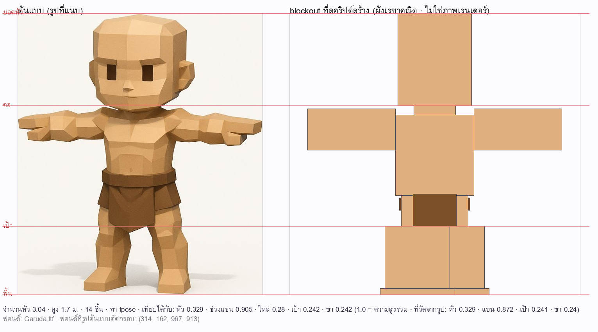
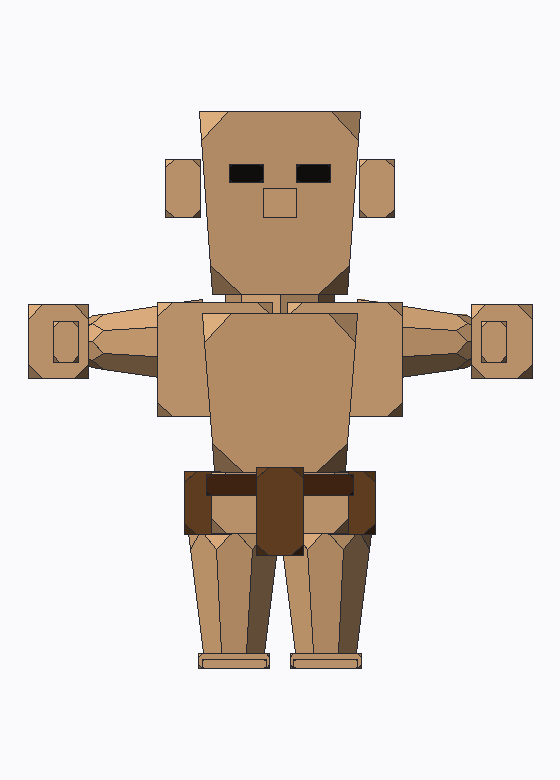
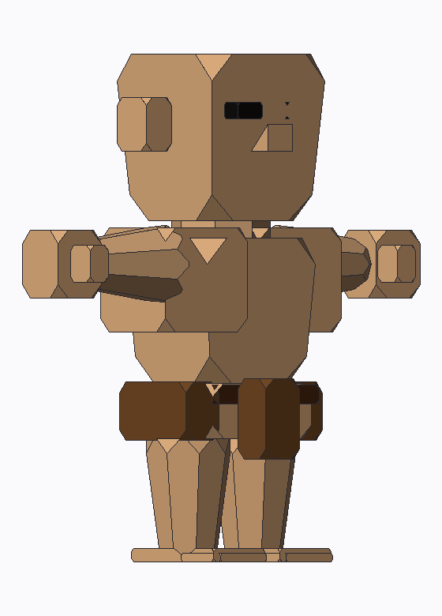
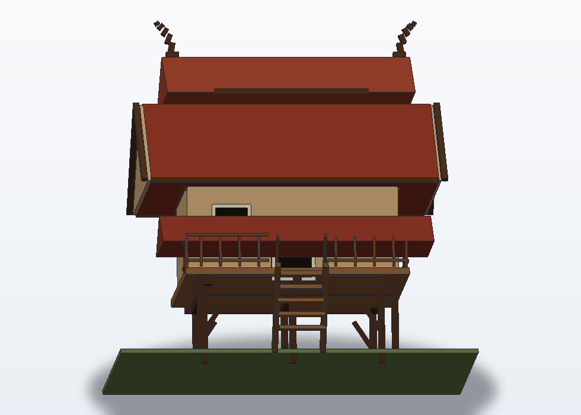

# 03 — สร้างตัวละคร 3D จากรูปที่แนบมา (ทำได้แค่ไหน ทำอย่างไร)

คำถาม: *"แนบรูปให้ Hermes แล้วบอกให้สร้างตามแบบลงใน Blender ได้ไหม"*

**คำตอบสั้น: ได้ — แต่ต้องเข้าใจขอบเขตให้ตรงกันก่อน**
Hermes **ดูรูปได้** และสร้าง **blockout** (ร่างด้วยรูปทรงพื้นฐานตามสัดส่วนที่วัดจากรูป)
ลงใน Blender ได้จริง แล้ว **ถ่ายภาพกลับมาดู** เพื่อปรับแก้ได้หลายรอบ
แต่ **ไม่ใช่** การปั้นโมเดลละเอียดจากรูปอัตโนมัติ (แบบนั้นต้องใช้บริการ image-to-3D ภายนอก)

---

## 1. ทำได้ / ทำไม่ได้ (ตรงไปตรงมา)

| งาน | ทำได้ไหม | หมายเหตุ |
|---|:---:|---|
| ดูรูปแล้วบอกสัดส่วน/สี/รายละเอียด | ✅ | Hermes มี vision ในตัว |
| สร้างตัวละคร **blockout** ตามสัดส่วนนั้น | ✅ | ตัวอย่างพร้อมใช้: [`examples/character_blockout.py`](../examples/character_blockout.py) |
| ถ่ายภาพผลลัพธ์กลับมาให้ AI ดูแล้วปรับ | ✅ | `mcp_blender_get_viewport_screenshot` |
| ใส่สีตามชุดสีในรูป · ใช้ HDRI จากห้องถ่ายจริง | ✅ | Poly Haven (CC0 ไม่ต้องใช้คีย์) |
| เขียนสคริปต์ `bpy` เพิ่มเอง (เสื้อผ้า/ผม/อุปกรณ์/แขนขาเพิ่ม) | ✅ | `execute_blender_script` |
| **ปั้นโมเดลละเอียดจากรูปอัตโนมัติ** (image-to-3D) | ❌ | ต้องใช้บริการ/โมเดล ML ภายนอก (ดูข้อ 6) |
| ริกกระดูกรองรับแอนิเมชันแบบมืออาชีพ | ⚠️ | เขียนสคริปต์สร้าง armature ได้ แต่ต้องติ๊กน้ำหนักต่อ (งานละเอียด ควรทำกับคน) |
| UV unwrap/ทำ texture map เอง | ⚠️ | ทำได้บางส่วนด้วยสคริปต์ แต่คุณภาพยังต้องใช้มือ |

> 💡 **ความจริงของวงการ:** blockout คือขั้นตอนที่คนทำ 3D ใช้จริงก่อนลงรายละเอียด
> การมี blockout ที่สัดส่วนถูกตั้งแต่ต้น ช่วยประหยัดเวลากว่านั่งปั้นผิดสัดส่วนไปครึ่งทาง

---

## 2. ขั้นตอนที่ใช้ได้จริง (7 ขั้น)

1. **แนบรูป** ใบเดียวที่เห็นตัวละครชัดทั้งตัว (ยืนตรง ฉากหลังเรียบ) มาพร้อมข้อความ
2. **ให้ AI อ่านสัดส่วนก่อน** — ไม่ใช่ให้สร้างทันที พรอมป์แนะนำ:
   > "ดูรูปนี้แล้วบอกสัดส่วน: สูงกี่หัว · ไหล่กว้างกี่เท่าหัว · แขนยาวเท่าไร · ขายาวเท่าไร
   > และบอกสีหลัก (ผิว/เสื้อ/กางเกง/ผม) เป็นค่า RGB 0–1"
3. **ตรวจสัดส่วนที่ AI อ่าน** — ถ้าไม่ตรงกับที่ตาเราดู แก้ตัวเลขก่อน (ขั้นนี้สำคัญที่สุด
   เพราะผลลัพธ์ทั้งงานขึ้นกับตัวเลขชุดนี้)
4. **ให้สร้าง blockout**:
   > "ใช้สคริปต์ `character_blockout.py` แก้ค่า CHARACTER ตามสัดส่วนนี้ แล้วส่งเข้า
   > `execute_blender_script`"
5. **ดูผลด้วยภาพ**:
   > "ถ่ายภาพฉากให้ดูหน่อย"  → AI จะเห็นว่าออกมาเป็นยังไง
6. **วนซ้ำ** — บอกสิ่งที่อยากแก้เป็นคำพูด ("ไหล่กว้างไป · แขนสั้นไป · หัวใหญ่ไป")
   AI จะแก้ตัวเลขแล้วสร้างใหม่
7. **ต่อยอด** — เพิ่มรายละเอียด (ข้อ 5) หรือเริ่มงานประกอบฉาก (ใช้ HDRI + เท็กซ์เจอร์จาก Poly Haven)

---

## 3. ตัวอย่างพรอมป์ที่ใช้ได้เลย

**แบบที่ 1 — เริ่มจากศูนย์**
> แนบรูป แล้วพิมพ์ว่า:
> "นี่คือตัวละครที่ผมอยากได้ ช่วยสร้างใน Blender ให้หน่อย
>  1) บอกสัดส่วนที่อ่านได้จากรูปก่อน
>  2) สร้าง blockout ให้ดู
>  3) ถ่ายภาพให้ดู แล้วรอผมสั่งแก้"

**แบบที่ 2 — ระบุสไตล์ชัดเจน**
> "สร้างตัวละครสไตล์การ์ตูนหัวโต (ประมาณ 4 หัว) สูง 1.6 ม. ชุดสีจากรูป
>  แล้วถ่ายภาพให้ดูทั้งด้านหน้าและด้านข้าง"

**แบบที่ 3 — ต่อยอดจาก blockout**
> "เพิ่มเสื้อแขนยาวกับรองเท้าให้ตัวละคร แล้วใส่ HDRI กลางแจ้งจาก Poly Haven
>  เพื่อให้แสงดูสมจริง แล้วถ่ายภาพมาให้ดู"

---

## 4. สคริปต์ตัวอย่าง — ใช้อย่างไร

ไฟล์: [`examples/character_blockout.py`](../examples/character_blockout.py)

ค่าที่ AI ต้องแก้คือก้อน `CHARACTER` ด้านบนไฟล์:

```python
CHARACTER = {
    "name": "Character",
    "height_m": 1.70,              # ส่วนสูงจริง (เมตร)
    "heads_tall": 7.5,             # สัดส่วน · 7.5 = มนุษย์จริง · 5 = การ์ตูน · 3 = ตุ๊กตา
    "shoulder_width_heads": 1.7,   # ไหล่กว้างกี่เท่าหัว
    "arm_length_heads": 3.0,
    "leg_length_heads": 3.8,
    "color_skin": (0.95, 0.76, 0.65),
    "color_shirt": (0.20, 0.45, 0.85),
    "color_pants": (0.15, 0.15, 0.20),
    "color_hair": (0.10, 0.08, 0.07),
}
```

ใช้ได้ 2 ทาง

| ทาง | วิธี |
|---|---|
| **ส่งให้ AI ผ่านเครื่องมือ** (แนะนำ) | พิมพ์: "ส่งโค้ดใน `examples/character_blockout.py` เข้า `execute_blender_script` โดยแก้ค่า CHARACTER ตามนี้: …" |
| **รันเองใน Blender** | `blender -b ไฟล์.blend --python examples/character_blockout.py` |

สคริปต์จะสร้าง 9 ชิ้น (ขา 2 · สะโพก · ลำตัว · แขน 2 · คอ · หัว · ผม) ไว้ในคอลเลกชัน
`Character` และ **คืนค่าสรุป** (ความสูงจริง · จำนวนหัวที่ทับได้ · รายชื่อชิ้นส่วน)
เพื่อให้ AI ตรวจสอบได้เองโดยไม่ต้องเดา

> ✅ โค้ดนี้ **ผ่านด่านความปลอดภัย** ของ `execute_blender_script` แล้ว (มีเทสต์ตรวจ)
> จึงวางส่งได้เลยโดยไม่ถูกปฏิเสธ

---

## 5. ต่อยอดได้อีก (บอก AI เป็นคำพูดได้เลย)

| อยากได้ | พูดว่า |
|---|---|
| ผิวเนียนขึ้น | "ใส่ subdivision level 2 ให้ชิ้นส่วนทั้งหมด แล้ว shade smooth" |
| แขนขาโค้งงอได้ | "สร้างโครงกระดูกง่าย ๆ ให้แขนกับขา แล้วผูกน้ำหนัก" |
| เสื้อผ้า/อุปกรณ์ | "เพิ่มหมวกกับกระเป๋าเป้ให้ตัวละคร" |
| แสงสวย ๆ | "ใส่ HDRI กลางแจ้งจาก Poly Haven แล้วถ่ายภาพให้ดู" |
| เก็บเป็นไฟล์งาน | "บันทึกเป็น `C:\งาน\ตัวละคร.blend`" |
| เทียบกับต้นแบบ | "ถ่ายภาพด้านหน้า 800×600 แล้วบอกว่าสัดส่วนต่างจากรูปตรงไหน" |

⚠️ งานที่ต้องใช้มือ (ปั้นละเอียด · ทำ UV · ริกมืออาชีพ) AI ช่วยร่าง/เขียนสคริปต์ให้ได้
แต่ผลลัพธ์สุดท้ายควรมีคนตรวจ — อย่าคาดหวังงานระดับสตูดิโอจากคำสั่งเดียว

---

## 6. ถ้าต้องการ image-to-3D จริง ๆ

โปรเจกต์นี้ **เลือกไม่ผูกกับคีย์ของบริการภายนอก** (สะพานใน Blender ใช้แค่ stdlib)
จึงไม่มีเครื่องมือ "รูป → โมเดล" ในตัว แต่ทำได้ 2 ทาง:

**ทางที่ 1 — ใช้บริการภายนอกแล้วนำเข้า** (ตรงไปตรงมา)

1. อัปโหลดรูปไปยังบริการ image-to-3D ที่คุณเลือก (มีทั้งแบบฟรีมีโควตาและแบบเสียเงิน)
2. ดาวน์โหลดผลลัพธ์เป็น `.glb` / `.obj`
3. ให้ AI นำเข้า:
   > "นำเข้าไฟล์ `C:\งาน\model.glb` เข้าฉาก แล้วถ่ายภาพให้ดู"

   (ใช้ `execute_blender_script`: `bpy.ops.import_scene.gltf(filepath="...")`)

**ทางที่ 2 — ให้ AI เขียนสคริปต์สร้างจากรูปทรง** (ไม่ต้องพึ่งใคร แต่ได้ blockout)

แบบนี้คือสิ่งที่ทำได้ทันทีในโปรเจกต์นี้ — และเป็นฐานที่ต่อยอดได้จริง

> 📝 **ความจริงที่ควรรู้:** ผลลัพธ์จาก image-to-3D มักได้ mesh ที่ topology ไม่เหมาะกับ
> การแอนิเมต (สามเหลี่ยมหนาแน่น ต้องรีโทโพโลยีต่อ) จึงควรใช้เป็น "จุดตั้งต้น"
> ไม่ใช่ชิ้นงานสุดท้าย — และบ่อยครั้ง blockout ที่สัดส่วนดีใช้ต่อได้ไวกว่า

---

## 7. เคสจริง: รูปตัวละครที่แนบมา (วัดจากพิกเซล ไม่เดา)

ตัวอย่างนี้ใช้รูปเรนเดอร์ตัวละคร **low-poly ท่า T-pose** (หัวโล้น · ตาสี่เหลี่ยม · เข็มขัด+ผ้าเตี่ยว ·
เท้าเปล่า · พื้นหลังขาว) — วัดด้วยสคริปต์อ่าน silhouette จากไฟล์รูปโดยตรง ได้ผล:

| วัดได้จากรูป | ค่า | วิธีวัด |
|---|---|---|
| ความสูงรวม | 751 px | กรอบของตัวละคร |
| ความสูงหัว | 247 px = **0.329** ของความสูง | จากยอดหัวถึงแถวที่แคบสุด (คอ) |
| จำนวนหัวที่ทับได้ | **3.04 หัว** | ความสูงรวม ÷ ความสูงหัว |
| ช่วงแขน (ปลายมือถึงปลายมือ) | **0.872** | แถวที่กว้างสุด |
| ความกว้างอก | **0.25** | แถวใต้แขน |
| "เป้า" (จุดที่ภาพแยกเป็น 2 ช่วง) | **0.241** จากพื้น | แถวแรกที่นับได้ 2 ช่วง |
| ความยาวขา | **0.24** | เป้าถึงฝ่าเท้า |
| สีผิว | `(0.88, 0.69, 0.50)` | สีที่พบบ่อยในตัวละคร |
| สีเข็มขัด | `(0.44, 0.25, 0.13)` | สุ่มตามเส้นกลางช่วงเอว |

> ⚠️ **ห้ามเดาด้วยตา** — ตอนแรกประเมินด้วยสายตาว่า "ช่วงแขน 1.35–1.40 เท่าความสูง"
> แต่พอวัดจริงได้ **0.872** (น้อยกว่าครึ่ง!) ถ้าใช้ค่าที่เดา ตัวที่ได้จะผิดสัดส่วนทั้งตัว

### แปลงค่าที่วัดได้ → สเปกในหน่วย "หัว"

| คีย์ใน `CHARACTER` | ค่า | เหตุผล |
|---|---|---|
| `heads_tall` | `3.04` | ตรงจากที่วัด |
| `shoulder_width_heads` | `0.85` | อกกว้าง 0.25 ของความสูง × 3.04 หัว ≈ 0.76–0.85 |
| `arm_length_heads` | `0.95` | แขนสั้นเกือบเท่าหัว (ตัวการ์ตูน) — ไม่ใช่ 3 หัวแบบคนจริง |
| `leg_length_heads` | `2.2` | ปรับให้ได้ขายาว 0.24 ของความสูง |
| `pose` | `"tpose"` | แขนกางตรงแนวนอนเหมือนรูป |
| `shirt` / `pants` / `hair` | `False` | อกเปล่า · ขาเปล่า · หัวโล้น |
| `face` / `belt` / `feet` | `True` | มีตา · เข็มขัด+ผ้าเตี่ยว · เท้า |
| สี | ผิว `(0.88,0.69,0.50)` · เข็มขัด `(0.44,0.25,0.13)` · ผ้า `(0.49,0.32,0.16)` | สุ่มจากรูป |

### ผลลัพธ์: blockout ที่ได้ เทียบกับที่วัด

| สัดส่วน | ที่วัดจากรูป | blockout ที่สร้าง | ต่าง |
|---|---|---|---|
| ความสูงหัว | 0.329 | **0.329** | 0.000 |
| ช่วงแขน | 0.872 | 0.905 | +0.033 |
| ความกว้างไหล่/อก | 0.25 | 0.28 | +0.03 |
| "เป้า" จากพื้น | 0.241 | **0.242** | +0.001 |
| ความยาวขา | 0.24 | 0.242 | +0.002 |

สร้างได้ **14 ชิ้น** (ขา 2 · เท้า 2 · สะโพก · เข็มขัด · ผ้าเตี่ยว · ลำตัว · แขน 2 · คอ · หัว · ตา 2)
และเทสต์บังคับว่าค่าที่ต่างได้ไม่เกิน ±0.03–0.08 — ดู `tests/test_example_character.py` ชุดที่ [5]



*ซ้าย = รูปต้นแบบที่แนบ · ขวา = blockout ที่สร้างจากสัดส่วนที่วัดจากพิกเซล
(วาดด้วย `tools/preview_blockout.py` · เส้นแดงคือระดับ ยอดหัว/คอ/เป้า/พื้น)*

### ลองเองได้ไม่ต้องมี Blender: วาดผังเทียบรูปก่อน

```bash
python -m pip install pillow          # เครื่องมือนี้ต้องใช้ Pillow (เฉพาะตอนพัฒนา)
python tools/preview_blockout.py --ref รูปต้นแบบ.jpg --out preview.png --set '{
  "heads_tall": 3.04, "shoulder_width_heads": 0.85, "arm_length_heads": 0.95,
  "leg_length_heads": 2.2, "pose": "tpose", "shirt": false, "pants": false,
  "hair": false, "face": true, "belt": true, "feet": true,
  "color_skin": [0.88, 0.69, 0.50], "color_belt": [0.44, 0.25, 0.13]}'
```

`tools/preview_blockout.py` จะ **รันสคริปต์จริง** (ผ่าน `bpy` ปลอม) แล้ววาดผังเรขาคณิตของทุกชิ้น
เทียบกับรูปต้นแบบในสเกลเดียวกัน พร้อมเส้นบอกระดับ (ยอดหัว/คอ/เป้า/พื้น)

> ภาพที่ได้เป็น **ผังเรขาคณิต** ไม่ใช่ภาพเรนเดอร์ — พอใจแล้วค่อยไปรันใน Blender จริง
> แล้วใช้ `mcp_blender_get_viewport_screenshot` ขอภาพเรนเดอร์

---

## 8. ยกระดับให้ละเอียดขึ้น (low-poly ลบมุม ที่ตรวจสอบได้)

blockout ด้วยกล่องทื่อดูเป็น "หุ่นกล่อง" — ของจริงในรูปเป็นงาน **low-poly ที่ลบมุมทุกมุม**
จึงเพิ่มขั้นที่สอง: สร้าง **เรขาคณิตเอง** (ไม่พึ่งการปั้นมือ) แล้วตรวจด้วยคณิตศาสตร์

### สามระดับที่เลือกได้

| ระดับ | เครื่องมือ | ได้อะไร | ตรวจอย่างไร |
|---|---|---|---|
| 1. blockout | `examples/character_blockout.py` | ร่างสัดส่วนด้วยกล่อง/แท่ง | รันใน `bpy` ปลอม + เทียบสัดส่วน |
| 2. **ละเอียด ( procedural )** | `tools/character_builder.py` | 27 ชิ้น · ลบมุมทุกมุม · แท่งสอบ · ตา/จมูก/หู/นิ้วโป้ง/เข็มขัด/ผ้าเตี่ยว | **ปิดสนิททุกชิ้น · ออยเลอร์ = 2 · ปริมาตรตรงสูตร · สัดส่วนตรงกับที่วัดจากรูป** |
| 3. เนียนแบบ organic | `examples/detail_character_in_blender.py` | Bevel + Subdivision + Shade Smooth ใน Blender | ทดสอบว่าเรียกคำสั่งครบ (ผลลัพธ์จริงต้องดูใน Blender) |

### หน้าตาจริง (เรนเดอร์ด้วย `tools/render_flat.py` — ไม่ได้ใช้ Blender)

| ด้านหน้า | มุม 3/4 |
|---|---|
|  |  |


*ซ้าย = รูปต้นแบบ · กลาง = โมเดลละเอียดด้านหน้า · ขวา = มุม 3/4 (สเกลความสูงเท่ากันทุกภาพ)*

> 📷 **ที่มาของภาพ:** รูปต้นแบบเป็นภาพตัวอย่างที่ผู้ใช้แนบมาเพื่อสาธิตวิธีวัดสัดส่วน
> (ไม่ได้อยู่ภายใต้สัญญาอนุญาตของโปรเจกต์) ส่วนภาพของโมเดลสร้างจากเมชของโปรเจกต์เอง
> · ถ้าเป็นเจ้าของภาพต้นแบบและไม่ประสงค์ให้เผยแพร่ ลบ `docs/images/01-*` และ `04-*` ได้เลย

### คำสั่งใช้งาน

```bash
# สร้างเมช + ส่งออก .obj/.mtl (ไม่ต้องใช้ Blender)
python tools/character_builder.py --out-dir out \
  --set '{"heads_tall":3.04,"shoulder_width_heads":0.85,"arm_length_heads":0.95,
          "leg_length_heads":2.2,"pose":"tpose","shirt":false,"pants":false,
          "hair":false,"face":true,"belt":true,"feet":true,
          "detail":{"limb_thick_heads":0.50}}'

# ดูหน้าตาก่อน (ต้องมี Pillow · เรนเดอร์ระนาบสีเรียบเอง)
python tools/character_builder.py --out-dir out --render front.png --rot-z 20
```

ใน Blender (หรือส่งให้ Hermes ผ่าน `execute_blender_script`):

```python
bpy.ops.wm.obj_import(filepath="out/character.obj")
# แล้วใช้ examples/detail_character_in_blender.py ปรับ Bevel/Subdiv/Shade Smooth
```

### ผลลัพธ์เทียบกับที่วัดจากรูป

| สัดส่วน | วัดจากรูป | blockout (ระดับ 1) | ละเอียด (ระดับ 2) |
|---|---|---|---|
| ความสูงหัว | 0.329 | 0.329 | **0.329** |
| ช่วงแขน | 0.872 | 0.905 | **0.905** |
| "เป้า" จากพื้น | 0.241 | 0.242 | **0.242** |
| ความยาวขา | 0.240 | 0.242 | **0.242** |
| ความกว้างขารวม | 0.332 | — | **0.329** |

ระดับ 2 ได้ **27 ชิ้น · 718 จุด · 413 หน้า** และทุกชิ้นผ่านการตรวจ:
ปิดสนิท (ทุกเส้นเชื่อมมีคู่) · หน้าหันออกนอก (ปริมาตรบวก) · ออยเลอร์ = 2 · ปริมาตรตรงสูตร
 analytic (กล่อง − 8×c³/6) · ไม่มีจุดซ้ำ/หน้าเสื่อม · ไฟล์ `.obj` มี `mtllib`/`usemtl` ครบ

> 🧠 **ทำไมต้องตรวจด้วยคณิตศาสตร์**: ในรอบพัฒนา ตัวตรวจจับได้ว่า **ขาสอบกลับด้าน**
> (ข้อเท้าใหญ่กว่าต้นขา) และ **มือใหญ่กว่าต้นแขน** — ทั้งสองอย่าง "ดูภาพแล้วพอผ่าน"
> แต่ผิดจริง ถ้าไม่มีเทสต์ก็จะส่งของเสียให้ผู้ใช้

### ขีดจำกัดที่ต้องพูดตรง ๆ

เรขาคณิตที่สร้างจากสูตร (กล่อง/แท่ง/ลิ่ม) ให้ **สัดส่วนถูกและได้ลุค low-poly**
แต่ยัง "แข็งเป็นเหลี่ยม" กว่ารูปที่ปั้นมือ · ทางที่ใกล้เคียงที่สุดเรียงตามความคุ้มค่า:

1. **Bevel + Shade Smooth ใน Blender** (ฟรี · เร็ว · ได้ผลชัด) — สคริปต์ให้แล้ว
2. **ปั้นต่อด้วยมือ** (Sculpt mode) ในจุดที่ต้องการ เช่น ใบหน้า/กล้ามเนื้อ — งานระดับนี้ต้องใช้คน
3. **image-to-3D จากบริการภายนอก** (Meshy/Rodin ฯลฯ) — ได้โมเดลละเอียด แต่ **ต้องใช้คีย์**
   และผลลัพธ์มักต้องรีโทโพโลยีต่อ

---

## 9. มี skill ใน Hub ที่ "ช่วยปั้น" ไหม? (ตรวจของจริงแล้ว)

ตรวจด้วย `hermes skills search` / `inspect` — ผลที่เกี่ยวข้องมีเท่านี้:

| Skill | แหล่ง | ทำอะไรจริง | ช่วย "ปั้น" ไหม |
|---|---|---|---|
| `blender` | clawhub (community) | รวมข้อควรระวัง/วิธีใช้ Blender | ❌ เป็นความรู้ ไม่ได้สร้างโมเดล |
| `official/creative/dream-loop` | official | สร้างฉาก 3D บน **เว็บ (three.js)** ให้ตรง concept art | ❌ คนละเครื่องมือ (ไม่ใช่ Blender) |
| `3d-maker-companion` | clawhub (@jaulustus) | งานพิมพ์ 3D/เลเซอร์ + สร้างโมเดลผ่าน **Meshy AI** + ทำภาพอ้างอิงสำหรับปั้น (Forger/ZBrush) | ⚠️ ผ่านบริการภายนอก (ต้องมีคีย์) |
| `meshy-3d-generation` | skills.sh (Meshy) | image-to-3D ผ่าน API ของ Meshy | ⚠️ ต้องมีคีย์ |

**สรุป:** ยังไม่มี skill ไหนที่ "ปั้นใน Blender ให้เสร็จ" — ที่มีคือ (ก) ความรู้การใช้ Blender
(ข) ตัวช่วยสร้างฉากบนเว็บ (ค) ตัวต่อบริการ image-to-3D ที่ต้องมีคีย์
โปรเจกต์นี้จึงเลือกทางที่ **ตรวจสอบได้และไม่ต้องใช้คีย์**: สร้างเรขาคณิตเอง + เทสต์ +
ให้สคริปต์ Bevel/Smooth ไปต่อใน Blender

---

## 10. ตัวอย่างที่ 2: บ้านทรงไทยสไตล์โพลิกอน

ไม่ใช่แค่ตัวละคร — ไปป์ไลน์เดียวกัน (`mesh_lib` → `.obj` → Blender) สร้าง **สถาปัตยกรรม** ได้ด้วย

| มุม 3/4 จากที่สูง | ด้านหน้า |
|---|---|
|  |  |

```bash
python tools/thai_house_builder.py --out-dir out --render house.png --rot-z 30 --rot-x 14
# ดูผล: 88 ชิ้น · 2,082 จุด · 1,217 หน้า · สูง 10.2 ม. · ปิดสนิททุกชิ้น
```

**องค์ประกอบที่ใส่ไว้** (ตามบ้านไทยดั้งเดิม): เสายกพื้นสูง + ใต้ถุนโปร่ง · ไม้ค้ำยัน ·
คานรับพื้น · พื้นไม้เรือน+ระเบียงผืนเดียว · ฝาเรือนพร้อมขอบบน/ล่าง · ประตู/หน้าต่างมีวงกบ ·
**หน้าบัน** สองหัวเรือน · **หลังคาชั้นล่าง + ชั้นบนซ้อนกัน ชัน 40.6°** · ขอบชายคา (fascia) ·
**ป้านลม** 4 แผ่น · **ช่อฟ้าโค้ง** (สร้างจาก 5 ท่อนเอียงเพิ่มขึ้น) · ระเบียง + ราวบน/ล่าง +
ลูกกรง · บันไดพร้อมไม้ข้างและราวจับ · แผ่นดินใต้เรือน

**เทสต์บังคับ "ความถูกต้องเชิงสถาปัตยกรรม" ไม่ใช่แค่ภาพสวย** (`tests/test_thai_house.py`, 65 ข้อ):
เสาแตะพื้น · พื้นอยู่บนเสา · ฝาอยู่บนพื้น · หลังคาอยู่บนฝา · สันอยู่บนสุด ·
**ช่อฟ้าต้องนั่งบนสันและโค้งออกจริง** · **หลังคาชัน ≥ 35°** · **บันไดไล่ลงถึงพื้น** ·
**ราวระเบียงต้องไม่ทับบันได** (ตรวจ AABB ทั้ง 3 มิติ ไม่ใช่ดูจากภาพ)

> 🔍 **บทเรียน**: AI ที่วิจารณ์ภาพบอกว่า "ราวทับบันได" — พอตรวจ AABB จริงพบว่า **ทับ 0 คู่**
> ภาพที่แน่นเกินทำให้ตาคน (และ AI) เข้าใจผิด · ตัวเลขจึงเป็นตัวตัดสิน
>
> ⚖️ **ระดับความงาม (ประเมินโดย AI วิจารณ์ภาพซ้ำหลายรอบ)**: 6/10 — ใช้เป็น
> **ภาพตัวอย่างประกอบ**ในคู่มือได้ ( silhouette อ่านออกว่าเป็นบ้านไทยครบองค์ประกอบ)
> แต่ยังไม่ใช่ **ภาพโชว์**: ช่อฟ้ายังเห็นเป็นขั้นบันไดเหลี่ยม และแสงแบน
> ถ้าต้องการภาพระดับโชว์ → เรนเดอร์ใน Blender (EEVEE + AO/แสงจริง) หรือเพิ่มจำนวนท่อนช่อฟ้า
