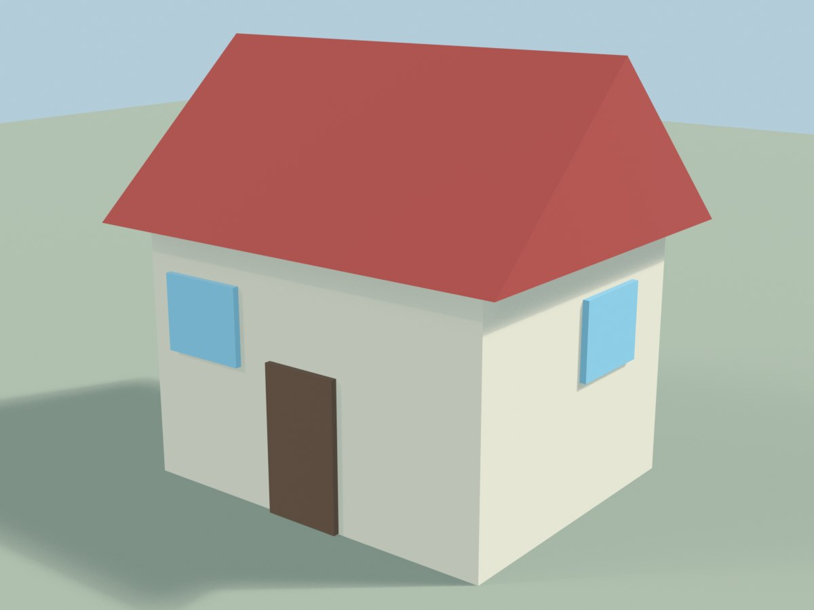

# 05 — ตัวอย่างจริง: สั่ง AI สร้างบ้าน (พร้อมผลลัพธ์)

เอกสารนี้บันทึก **คำสั่งจริงที่ใช้ได้ผล** กับผลลัพธ์จริงจาก Hermes + Blender
— ไม่ใช่ตัวอย่างสมมติ — พร้อมจุดที่ยังปรับได้และคำสั่งฉบับปรับปรุง

---

## 1. คำสั่งที่ใช้ (คัดลอกได้เลย)

> สร้างบ้านหลังเล็ก ๆ 5 ชิ้น ทุกครั้งที่สร้างงานเสร็จ ให้เรียก show_in_blender ปิดท้ายด้วย

**เงื่อนไขที่ทำให้ได้ผล:** ต้องอยู่ในโหมดที่เปิด Blender ได้ (headless ก็ได้ เพราะ
`show_in_blender` เปิดหน้าต่างให้เอง) และควรตั้ง timeout ไว้ที่ 300 วินาที

---

## 2. ผลลัพธ์ที่ได้



*บ้าน low-poly ที่ Hermes สร้างเองจากคำสั่งข้างบน — 1200×900 เรนเดอร์จาก Blender*

**ตรวจจากภาพ (นับได้จริง):**

| ชิ้น | รายละเอียด |
|---|---|
| 1. ผนัง | กล่องสีครีม 1 ก้อน |
| 2. หลังคา | ทรง **hip roof** (ปั้นหยา) 4 ด้านลาด สีแดงอิฐ |
| 3. ประตู | แผ่นสีน้ำตาล 1 บาน |
| 4–5. หน้าต่าง | สี่เหลี่ยมสีฟ้าอ่อน 2 บาน (ด้านหน้า + ด้านข้าง) |
| + พื้น | แผ่นสีเขียวอ่อน 1 แผ่น (AI ใส่ให้เอง) |

ได้ **5 ชิ้นตามที่สั่งครบ** ✅ และจบด้วย `show_in_blender` → เปิดหน้าต่าง Blender
ให้เห็นของจริง (ไม่ใช่แค่ภาพนิ่ง — หมุน/ซูมดูได้)

---

## 3. จุดที่ยังปรับได้ (วิจารณ์ตรง ๆ)

| จุด | อาการ | ทำไม |
|---|---|---|
| ประตู | เยื้องไปทางซ้าย ดูไม่สมดุล | AI วางตามตำแหน่งที่เดา ไม่ได้กำหนดพิกัดในคำสั่ง |
| หน้าต่าง | เป็นแผ่นแปะ ไม่มีกรอบ/ความลึก | คำสั่งบอกแค่ "5 ชิ้น" จึงทำแบบหยาบที่สุด |
| ประตู | ไม่มีช่องเจาะ/วงกบ | เช่นเดียวกัน — ไม่ได้ระบุรายละเอียด |
| เงา | แข็ง | ใช้ light ขนาดเล็ก (point/sun) |

> 💡 **บทเรียน:** คำสั่งสั้นได้ผลเร็ว แต่รายละเอียดจะหยาบตามคำสั่ง —
> ถ้าอยากได้งานละเอียด ต้องบอก **ขนาด ตำแหน่ง และรายละเอียด** ลงไป

---

## 4. คำสั่งฉบับปรับปรุง (แก้ทั้ง 4 จุดในครั้งเดียว)

> ปรับบ้านหลังเดิม: ย้ายประตูไปกลางผนังด้านหน้า · ทำหน้าต่างเป็นช่องฝังลึกพร้อมกรอบนูน
> 2 ซม. · เจาะช่องประตูให้มีวงกบ · เปลี่ยนแสงเป็น area light ขนาดใหญ่ขึ้น ·
> เพิ่มบันไดหน้าประตู 2 ขั้น · แล้วเรียก show_in_blender ปิดท้าย

**เทคนิคการเขียนคำสั่งที่ได้ผล (จากที่ทดลองจริง)**

1. **บอกจำนวนชิ้น** — "5 ชิ้น" ทำให้ AI วางแผนชัดและไม่สร้างเกิน
2. **บอกพิกัด/ขนาด** ถ้าต้องการตำแหน่งที่แน่นอน — เช่น "ประตูกลางผนัง ที่ (0,-3,1)"
3. **บอกวัสดุ/สี** — "หลังคาแดงอิฐ ผนังครีม" ได้สีที่ต้องการ
4. **ปิดท้ายด้วย `show_in_blender`** — เพื่อให้เห็นผลจริงในหน้าต่าง Blender
5. **ถามให้ AI ถ่ายภาพตรวจงานตัวเอง** — "ถ่ายภาพมาให้ดูหน่อย" (มันจะเห็นภาพแล้วแก้ต่อ)

---

## 5. เส้นทางการทำงาน (สิ่งที่เกิดขึ้นเบื้องหลัง)

```
คำสั่งภาษาธรรมชาติ
   ↓
Hermes เรียก add_primitive_mesh × 5      (สร้างกล่อง/หลังคา/ประตู/หน้าต่าง)
   ↓
set_object_material                       (ใส่สี: ครีม/แดงอิฐ/น้ำตาล/ฟ้า)
   ↓
get_viewport_screenshot                   (AI "เห็น" งานตัวเอง → ตรวจ → แก้)
   ↓
show_in_blender                           (บันทึก .blend + เปิดหน้าต่างให้คนดู)
```

**โหมดที่ใช้ได้**

| โหมด | ผล |
|---|---|
| headless (ค่าปริยาย) | AI สร้างใน Blender ที่ซ่อนอยู่ → `show_in_blender` เปิดหน้าต่างใหม่ให้ดู |
| `--gui` | หน้าต่างเปิดตั้งแต่ครั้งแรก และเห็นของโผล่ทีละชิ้น ✅ |
| `--attach` (add-on) | ใช้หน้าต่างที่คุณเปิดอยู่ ✅ |

---

## 6. ต่อยอด

- อยากได้บ้านทรงไทยละเอียด 88 ชิ้น (เสายกพื้น · หลังคาซ้อน · ช่อฟ้า · ระเบียง):
  ใช้ตัวสร้างในโปรเจกต์ — ดู [`03-สร้างตัวละครจากรูป.md`](03-สร้างตัวละครจากรูป.md) §10
- อยากได้ของฟรีจากคลัง CC0 (เก้าอี้/ต้นไม้/โคมไฟ):
  > ค้นเก้าอี้ใน Poly Haven เลือกที่โพลีต่ำสุด โหลดเป็น gltf 1k มาวางข้างบ้าน แล้วถ่ายภาพให้ดู
- อยากให้ AI ตรวจงานตัวเองทุกครั้ง:
  > ทุกครั้งที่สร้างเสร็จ ให้ถ่ายภาพ viewport ตรวจว่ามีชิ้นไหนลอย/ทับกัน แล้วแก้ให้
